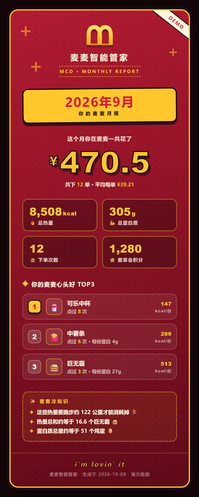
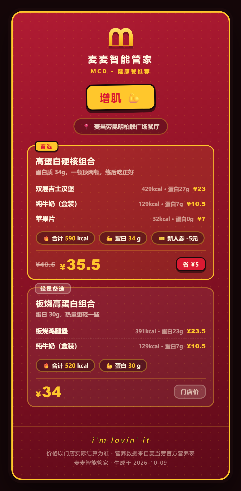
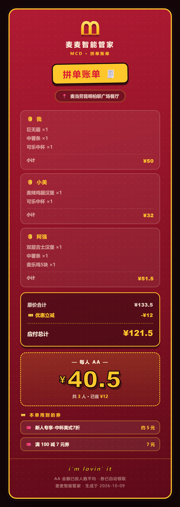

# 🍔 麦麦智能管家 · maimai-butler

> 一个基于**麦当劳中国官方 MCP** 的智能饮食管理助手——帮麦友把每一顿麦麦吃得更健康、更省钱。

麦麦智能管家是一个 Agent Skill。它把麦当劳 MCP 的订单、营养、门店、优惠券、下单能力，编排成三条完整的用户价值链路，并把数据结果渲染成**可截图分享的麦当劳品牌风格卡片**。

---

## ✨ 项目功能

### 📊 模块一：月度饮食报告
**"看看我这个月吃了什么" → 一张 Wrapped 式月报卡片**

- 拉取历史订单并按月份过滤
- 与麦当劳官方营养表（约 160 条餐品）自动匹配，统计：**总消费 / 总热量 / 总蛋白质 / 下单次数 / 最常点 TOP3**
- 展示麦享会积分余额
- 生成**深红渐变 + 红黄配色 + 复古像素风**的品牌卡片，适合截图发朋友圈



### 💪 模块二：健康餐推荐
**"我要增肌 / 减脂 / 控制热量" → 2-3 个带营养与省钱测算的套餐组合**

- 搜索门店 → 查询菜单 → 匹配官方营养数据
- 按目标定制组合：增肌（高蛋白 ≥25g）、减脂（≤500 大卡）、控热量
- 精确算价 + 测算可用优惠券能省多少
- 生成的推荐卡片包含：每份商品的热量 / 蛋白质 / 价格 / 券后省额



### 💰 模块三：省钱拼单
**"我和朋友一起点，怎么买最划算" → 一键领券 + 自动算账 + AA 拆分**

- 收集人数与每人需求 → 查菜单
- 自动领取全部可用优惠券
- 计算：原价 / 优惠后价格 / **每人 AA 金额**
- 生成拼单账单卡片；经用户二次确认后，可直接**创建订单**完成闭环



---

## 📦 安装

### 前置要求
- WorkBuddy（或任何支持 Agent Skill 规范 + MCP 的客户端）
- 麦当劳 MCP Token：前往 [open.mcd.cn/mcp](https://open.mcd.cn/mcp) 手机号登录 → 控制台 → 激活申请

### 安装步骤

**1. 放置 Skill 实体**

```bash
# 将本目录放置到你的 skills 根目录（示例）
D:\Skills\WorkBuddySkills\maimai-butler\
```

**2. 建立 junction 接入 WorkBuddy**（PowerShell，无需管理员权限）

```powershell
New-Item -ItemType Junction `
  -Path "$env:USERPROFILE\.workbuddy\skills\maimai-butler" `
  -Target "D:\Skills\WorkBuddySkills\maimai-butler"
```

**3. 配置麦当劳 MCP**（`~/.workbuddy/mcp.json`）

```json
{
  "mcpServers": {
    "mcd-mcp": {
      "type": "streamablehttp",
      "url": "https://mcp.mcd.cn",
      "headers": { "Authorization": "Bearer YOUR_MCP_TOKEN" }
    }
  }
}
```

**4. 新开一个对话，直接说"看看我的麦麦月报"即可触发 ✨**

> 💡 没有历史订单也能体验：管家会主动询问是否用内置演示数据预览卡片效果（卡片带 DEMO 角标）。

---

## 🚀 使用示例

### 示例一：月度饮食报告

**你**：看看我这个月吃了什么 🥺

**管家**：收到！正在翻你的麦麦订单…

> 【卡片】2026年9月 · 麦麦月报
> - 总消费 **¥470.5** ｜ 12 单 ｜ 平均 ¥39.2/单
> - 热量 **8,508 kcal** ｜ 蛋白质 **305g**
> - 心头好 TOP1：**可乐中杯**（点过 8 次）
> - 麦享会积分：1,280
>
> 📸 卡片已生成 `麦麦月报_2026-09.html`，截图就能发朋友圈！

### 示例二：健康餐推荐

**你**：我想增肌，今天吃什么好？

**管家**：💪 增肌安排！你在哪个城市？帮你找附近门店～

**你**：昆明 南屏街

**管家**：（列出门店供选择）…已按门店算好价格和优惠券：

> 【卡片】增肌组合推荐
> - 🥇 **首选 · 高蛋白硬核组合**：双层吉士汉堡 + 纯牛奶 + 苹果片
>   = 蛋白 **34g** / 590 kcal / 券后 **¥35.5**（省 ¥5）

### 示例三：省钱拼单

**你**：我和两个朋友一起点，怎么买最划算？

**管家**：💰 拼单模式启动！每人想吃什么？

**你**：我要巨无霸+薯条+可乐，小美要麦辣鸡腿堡+可乐，阿强要双层吉士+薯条+麦乐鸡

**管家**：已自动领取全部可用券 🎫

> 【卡片】拼单账单
> - 原价 ¥133.5 → 优惠 -¥12 → 应付 **¥121.5**
> - **每人 AA ¥40.5** ｜ 已省 ¥12

**管家**：要现在下单吗？（下单前我会跟你确认金额）

**你**：下吧

**管家**：请确认：门店「昆明柏联广场餐厅」；商品：巨无霸×1、中薯条×1…；合计 **¥121.5**。**确认下单吗？**

**你**：确认

**管家**：订单已创建！可以扫码或打开麦当劳 APP 支付～支付完成后回我一声，我帮你查订单状态。

---

## 👥 目标用户

| 用户 | 痛点 | 管家提供 |
|---|---|---|
| 麦当劳常客 | 想知道自己到底吃了多少、花了多少 | 月度报告一图看懂 |
| 健身 / 减脂人群 | 想吃麦麦又怕热量超标 | 目标导向的营养组合推荐 |
| 学生党 / 拼单党 | 多人算账麻烦、优惠券总用不上 | 一键领券 + AA 自动算账 |
| 爱分享的年轻人 | 想要好看的个人数据总结 | Wrapped 式品牌卡片 |

---

## 🛠 技术栈

| 层 | 技术 | 说明 |
|---|---|---|
| 交互层 | Agent Skill（SKILL.md） | 定义三模块路由、工作流、安全红线 |
| 数据层 | 麦当劳中国官方 MCP（mcd-mcp） | Streamable HTTP，35 个官方工具 |
| 计算层 | Python 3（纯标准库，零依赖） | `report_calc.py` 匹配聚合、`render_card.py` 渲染 |
| 呈现层 | 单文件 HTML + CSS + JS | 品牌视觉卡片，JS 数据注入，可离线打开、截图分享 |

---

## 📁 目录结构

```
maimai-butler/
├── SKILL.md                    # 技能主入口：三模块路由、工作流、安全红线
├── README.md                   # 项目说明（本文档）
├── MCP_INTEGRATION.md          # MCP 集成说明（工具清单与调用链路）
├── references/
│   ├── mcd-playbook.md         # 35 个 MCP 工具全参数手册 + 实测坑位
│   └── card-schema.md          # 三种卡片的数据结构定义
├── assets/
│   ├── card_monthly.html       # 月度报告卡片模板
│   ├── card_recommend.html     # 健康推荐卡片模板
│   ├── card_split.html         # 拼单账单卡片模板
│   └── demo/                   # 演示与兜底数据
│       ├── demo_orders.json         # 示例订单（12 单，真实商品与价格）
│       ├── demo_points.json         # 示例积分账户
│       └── nutrition_snapshot.txt   # 官方营养表快照（160 条）
└── scripts/
    ├── report_calc.py          # 订单↔营养匹配聚合计算器
    └── render_card.py          # 卡片渲染器（数据注入模板）
```

---

## ⚠️ 使用须知

- 所有数据（商品、价格、营养、优惠券）均来自麦当劳官方接口，**真实可溯源，绝不编造**
- 任何**下单操作**都会先复述"门店 + 商品 + 总价"并等待用户明确确认，保障资金安全
- 使用演示数据生成的卡片会带 **DEMO** 角标，并明确告知用户
- MCP Token 属于个人敏感凭证，请妥善保管，不要提交到公开仓库
